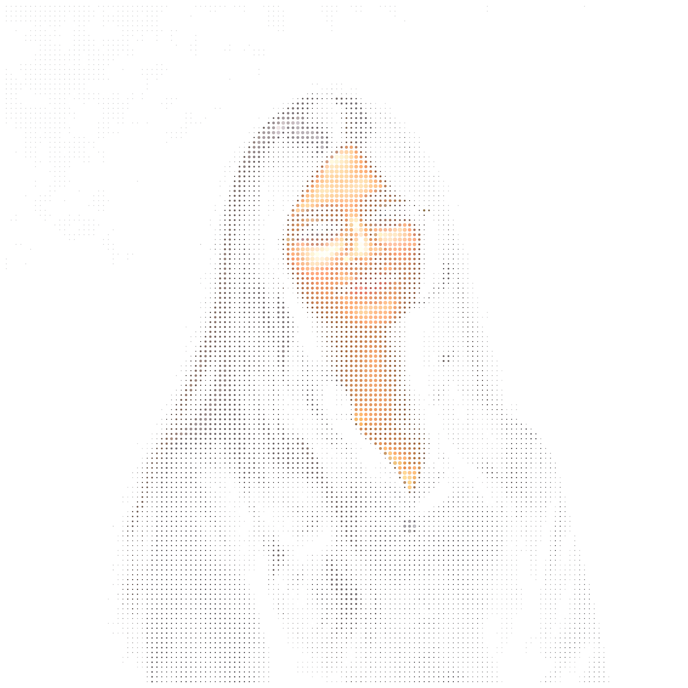
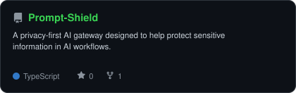
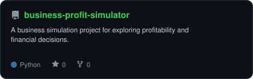
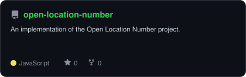
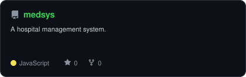
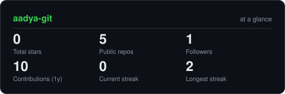

<div align="center">

  <!-- PROFILE HEADER -->

  <br><br>

  <a href="https://github.com/aadya-git">
    
  </a>

  <br><br>

</div>

<!-- SOCIAL LINKS: Replace the placeholders with your actual profile URLs -->

<div align="center">

<a href="https://www.linkedin.com/in/aadya-sharma-640793289">
  
</a>

<a href="mailto:aadyarko@gmail.com">
  
</a>

<br>


</div>

---

## `~/` whoami

```console
$ cat about.txt
```

Hey, I'm **Aadya**
An Electronics and Communication Engineering student who somehow ended up falling down the rabbit hole of AI, software, and building things that solve real problems.

I've gone from exploring how things work at **Delhi Metro (DMRC)** to working on software and AI projects with a **Canada-based company** and I'm still figuring out how much more there is to build.

I've explored everything from AI-powered tools to hackathons and startup culture at **IIT Bombay.** I enjoy the messy part of building, figuring things out, breaking things and learning enough to make them work.

- Currently exploring **AI, software development, and backend engineering**
- Interested in **building practical products, not just tutorials**
- Hackathon experiences: **Won 5 hackathons from recognised institutes including NIT Delhi**
- Was part of the **entrepreneurship and startup ecosystem at IIT- Bombay**
- Always learning, experimenting and building something new

> A little code, a lot of curiosity and plenty of experiments. 🚀

---

<div align="center">

## `~/` toolbox

### Programming Languages


### AI & Machine Learning


**Machine Learning · Natural Language Processing · TensorFlow · PyTorch**

### Backend Development


**FastAPI · SQLAlchemy · REST APIs**

### Databases


**SQL · PostgreSQL · Relational Databases**

### DevOps & Developer Tools


</div>

---

<div align="center">

## `~/` skill radar

<table>
<tr>
<td width="50%" align="center" valign="middle">

<!-- Generated from assets/skills.json -->

<p><strong>Self-assessed skills</strong></p>

<picture>
  <source media="(prefers-color-scheme: dark)" srcset="assets/radar-dark.svg">
  <source media="(prefers-color-scheme: light)" srcset="assets/radar-light.svg">
  
</picture>

</td>
<td width="50%" align="center" valign="middle">

<!-- Generated from repository language statistics -->

<p><strong>Languages across repositories</strong></p>

<picture>
  <source media="(prefers-color-scheme: dark)" srcset="assets/radar-langs-dark.svg">
  <source media="(prefers-color-scheme: light)" srcset="assets/radar-langs-light.svg">
  
</picture>

</td>
</tr>
</table>

</div>

---

<div align="center">

## `~/` selected work

*Some things I've built, explored, and learned from along the way.*

<table>
<tr>
<td width="50%" align="center">

<a href="https://github.com/The-Fourmidables/Prompt-Shield">
  <picture>
    <source media="(prefers-color-scheme: dark)" srcset="assets/card-Prompt-Shield-dark.svg">
    <source media="(prefers-color-scheme: light)" srcset="assets/card-Prompt-Shield-light.svg">
    
  </picture>
</a>

<br>

<strong>Prompt Shield</strong>

<p>A privacy-first AI gateway project focused on protecting sensitive information in AI workflows.</p>

</td>
<td width="50%" align="center">

<a href="https://github.com/aadya-git/business-profit-simulator">
  <picture>
    <source media="(prefers-color-scheme: dark)" srcset="assets/card-business-profit-simulator-dark.svg">
    <source media="(prefers-color-scheme: light)" srcset="assets/card-business-profit-simulator-light.svg">
    
  </picture>
</a>

<br>

<strong>Business Profit Simulator</strong>

<p>A project exploring business profitability, financial scenarios, and decision-making.</p>

</td>
</tr>
<tr>
<td width="50%" align="center">

<a href="https://github.com/aadya-git/open-location-number">
  <picture>
    <source media="(prefers-color-scheme: dark)" srcset="assets/card-open-location-number-dark.svg">
    <source media="(prefers-color-scheme: light)" srcset="assets/card-open-location-number-light.svg">
    
  </picture>
</a>

<br>

<strong>Open Location Number</strong>

<p>A location-focused software project exploring ways to represent and work with geographic locations.</p>

</td>
<td width="50%" align="center">

<a href="https://github.com/aadya-git/medsys">
  <picture>
    <source media="(prefers-color-scheme: dark)" srcset="assets/card-medsys-dark.svg">
    <source media="(prefers-color-scheme: light)" srcset="assets/card-medsys-light.svg">
    
  </picture>
</a>

<br>

<strong>MedSys — Hospital Management System</strong>

<p>A hospital management project focused on organizing healthcare-related information and workflows.</p>

</td>
</tr>
</table>

</div>

---

<div align="center">

## `~/` the numbers

<!-- Generated by scripts/cards.py -->

<picture>
  <source media="(prefers-color-scheme: dark)" srcset="assets/card-stats-dark.svg">
  <source media="(prefers-color-scheme: light)" srcset="assets/card-stats-light.svg">
  
</picture>

<br><br>

<!-- Generated by the Metrics workflow -->


<br><br>

</div>

---

<div align="center">

## `~/` contributions

<!-- Generated by the Metrics workflow -->


<br><br>

<!-- Generated by the Snake workflow -->

<picture>
  <source media="(prefers-color-scheme: dark)" srcset="https://raw.githubusercontent.com/aadya-git/aadya-git/output/snake-dark.svg">
  <source media="(prefers-color-scheme: light)" srcset="https://raw.githubusercontent.com/aadya-git/aadya-git/output/snake.svg">
  
</picture>

</div>

---

<div align="center">

## `~/` beyond the code

```text
curiosity > comfort
ideas      > excuses
building   > overthinking
```

I like exploring new ideas, participating in hackathons, learning from people who build things, and turning experiments into projects.

Still learning. Still building. Just getting started. 🌱

<br>

<sub>01100011 01110101 01110010 01101001 01101111 01110011 01101001 01110100 01111001</sub>

<br><br>


</div>